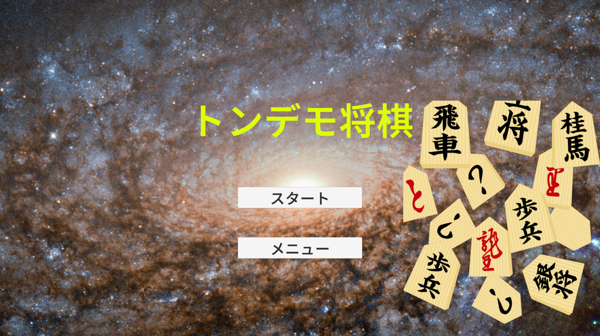
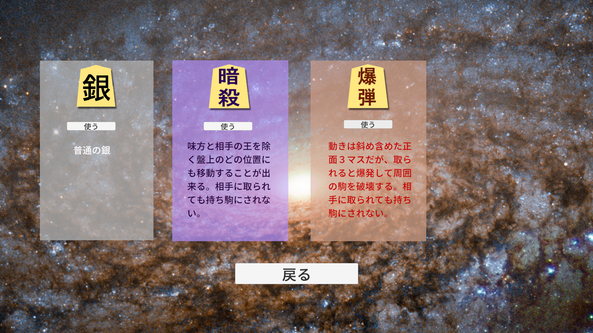
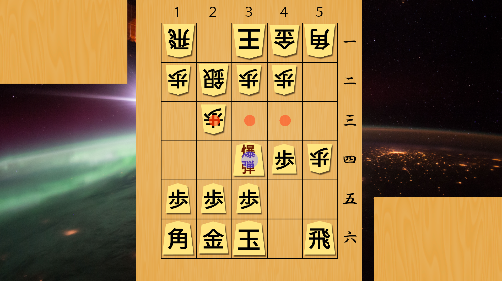

# トンデモ将棋

5×6の盤で遊ぶ、特殊駒入りの将棋ゲームです。プレイヤーは先手、相手はCPUです。通常の銀の代わりに「暗殺者」か「爆弾」を選べます。

## ブラウザで遊ぶ

このリポジトリにはWeb版のビルド成果物を含めていません。最初にUnityでWeb向けにビルドし、生成された `index.html` をローカルサーバーで開きます。必要なものは **Unity `6000.0.45f1`（Web Build Support付き）** と、VS Codeの [Live Server拡張](https://marketplace.visualstudio.com/items?itemName=ritwickdey.LiveServer) です。

1. Unity Hubでこのフォルダをプロジェクトとして開きます。
2. Unityの **File > Build Profiles** で **Web** を選び、**Build** を実行します。出力先にはプロジェクト内の `Build/WebGL` を指定します。
3. ビルド後、VS Codeの **File > Open Folder** で `Build/WebGL` フォルダを開きます。
4. 生成された `index.html` を右クリックし、**Open with Live Server** を選びます。開いたブラウザでゲームが動きます。

`Build/` はGit管理から除外されているので、clone直後には存在しません。VS Codeでプロジェクト全体を開いたときも設定上 `Build/` が非表示になるため、手順3ではビルド出力フォルダを直接開きます。ゲームのコードを変えたらUnityで再ビルドしてください。Live Serverは生成済みファイルを配信するだけです。

以前作ったWeb版の出力フォルダが別の場所に残っている場合は、そのフォルダをVS Codeで開き、`index.html` から手順4へ進めます。

### Unity Editor内で試す場合

`Assets/Scenes/Title.unity` を開いてEditor上部の **Play** ボタンを押すと、ビルドせずに動作確認できます。

タイトルの「メニュー」で駒を選び、「戻る」でタイトルへ戻れます。未選択時は通常の銀です。「スタート」で対局が始まります。

### GitHubから取得する場合

このプロジェクトでは、日本語フォントの大きなアセットを **Git LFS** で管理しています。Git LFSを導入したうえでcloneしてください。

```powershell
git lfs install
git clone https://github.com/Tobigusoku/tondemoShogi.git
```

Git LFSを導入する前にcloneした場合は、プロジェクトのフォルダ内で `git lfs pull` を実行するとフォント本体を取得できます。

## 操作とルール

- 自分の駒をクリックし、表示された移動先をクリックして動かします。同じ駒をもう一度クリックすると選択を解除できます。
- 取った通常駒は自分の駒台に加わります。駒台の駒をクリックして空きマスに打てます。歩の二歩はできません。
- 歩、銀、角、飛車は相手側の2段に入るか、その2段から動くと自動で成ります。
- 相手の王を取ると勝ちです。このゲームは王手・詰みではなく、王の捕獲で勝敗が決まります。
- 暗殺者は、味方の駒と両王がいない任意のマスへ移動できます。取られても持ち駒にはなりません。
- 爆弾は前方と前方斜めの3方向へ1マス動きます。取られると、取った駒を含む爆心地と周囲8マスの駒が消滅します。巻き込まれた駒は持ち駒になりません。

## 現在の状態

CPUは取れる駒を優先し、それ以外の移動先はランダムに選びます。現状ではCPUが取った駒は相手の駒台に表示されず、持ち駒を打つこともできません。改善の順序と見積もりは [Project Counterplay](PROJECT_COUNTERPLAY.md) にまとめています。

## スクリーンショット

### タイトル画面



### 駒選択メニュー



### 対局画面


